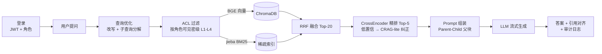

# LiteRAG · 轻量级中文知识库问答系统

从零实现（不依赖 LangChain/LlamaIndex 编排框架）的 RAG（Retrieval-Augmented Generation）知识库问答系统：
**混合检索 → RRF 融合 → CrossEncoder 精排 → LLM 查询改写 → 带引用溯源的流式生成**，附带可一键复现的消融实验。
单机 CPU 即可运行，开箱内置演示语料，**无需任何 API Key 即可端到端跑通**（离线演示模式）。

## 核心特性

| 能力 | 说明 |
| --- | --- |
| 🔀 混合检索 | BM25（jieba 稀疏）+ 向量（BGE）双路召回，RRF（Reciprocal Rank Fusion）融合，缓解单一召回的语义/关键词盲区 |
| 🎯 两阶段检索 | 粗排召回 Top-20 → CrossEncoder（bge-reranker）精排 Top-5，数据量增大时优势更明显（参考 QAnything 架构） |
| ✍️ 查询优化 | LLM 查询改写 + 子查询分解（多查询分别召回后融合）；可选 HyDE 假想文档检索；**多轮对话支持历史指代消解** |
| 🩹 CRAG-lite 纠正重查 | 精排 Top1 置信分低于阈值时自动扩大候选重查一次（简化版 Corrective RAG），前端可视化提示 |
| 🧩 Parent-Child 分块 | 小块（chunk）负责精准检索，命中后以章节父块全文（截断）作为生成上下文——检索精度与上下文完整性兼得 |
| 🔐 认证与分级权限 | SQLite 用户表 + PBKDF2 密码哈希 + 手写 HS256 JWT（标准库零依赖）；角色 boss/employee/guest → 文档密级 L1-L4，检索层 `where` 过滤（默认拒绝，无权限内容不进入任何下游环节）；**boss 可在文档列表中运行时调整任意文档密级（立即生效，无需重灌）**；问答审计日志（仅 boss 可查） |
| ⚙️ 运行时设置面板 | boss 专属：LLM 端点热更新（key 掩码显示）+ 一键流式测速（首字延迟）、7 个功能开关、检索参数即时生效、审计日志查看——配置自动原子写回 .env，无需重启 |
| 👁️ 多模态图片理解 | 摄入时抽取 PDF/Word 内嵌图片 → 识图模型生成中文描述入库（可单独配置识图端点，默认复用主模型；尺寸过滤/数量上限/失败重试，优雅降级）；**支持图片文件直接上传入库 + 聊天贴图提问**——图表里的数字变得可检索、可问答 |
| 📎 引用溯源 | 答案内联 [1][2] 角标，前端可点击查看来源文档、章节路径、相关度分数 |
| 🌊 流式输出 | FastAPI SSE：先推送检索轨迹（改写后的查询/各路命中/分阶段耗时），再打字机式输出答案 |
| 🧩 Provider 可插拔 | LLM / Embedding / Reranker 三层均为抽象接口，支持本地模型与 API（SiliconFlow、DeepSeek、智谱、Qwen…）配置切换 |
| 📊 评估体系 | 自建 60 条中文评测集（含字面相近的干扰文档与跨文档对比题）+ 465 chunks 真实开源语料复测，Hit@5 / MRR@10 / 关键词覆盖率，四级配置一键消融（`eval/ablation.py`） |
| 🧪 工程化 | 56 个 pytest 单测（全离线运行，含权限/认证/设置面板/视觉用例）、Dockerfile、结构化配置（.env）、进程级单例与懒加载 |

## 系统架构



> 分层职责、请求生命周期、数据模型、权限模型与扩展点的完整描述见 [ARCHITECTURE.md](ARCHITECTURE.md)。

**检索链路四级配置**（前端可切换，现场对比消融效果）：

```
naive   仅向量召回                    —— baseline
hybrid  + BM25 稀疏召回 + RRF 融合
rerank  + CrossEncoder 精排
full    + LLM 查询改写 / 子查询分解   —— 完整链路
```

## 快速开始

### 方式一：一键启动（推荐，适合所有人）

**双击项目根目录的 `一键启动.bat`**（或桌面快捷方式）即可，脚本会自动完成所有检查：

1. 运行环境不存在或损坏 → 自动创建 / 重建并安装依赖
2. 本地模型缺失 → 自动从国内镜像下载（约 1.2GB，仅首次）
3. 知识库索引为空 → 自动灌入内置演示文档
4. 启动服务并自动打开浏览器（首次提问需加载模型，约 30 秒）

关闭窗口或按 Ctrl+C 即停止服务；也可双击 `一键停止.bat`。

### 方式二：手动命令行

```bash
# 1. 环境（需 Python 3.12，推荐 uv）
uv venv --python 3.12
uv pip install --python .venv/Scripts/python.exe -r requirements.txt

# 2. 配置（默认离线演示模式，无需任何 key）
copy .env.example .env        # macOS/Linux: cp .env.example .env

# 3. 下载本地模型（约 1.2GB，只需一次；默认走国内镜像，模型存放在项目 models/ 目录）
python scripts/download_models.py

# 4. 灌入内置演示语料
python scripts/ingest.py

# 5. 启动
uvicorn app.main:app --reload
# 打开 http://127.0.0.1:8000，登录后使用
```

内置演示账号：`boss/boss123`（全权限）、`employee/employee123`（不可见机密）、`guest/guest123`（仅公开）。机密文档用 `python scripts/ingest.py data/confidential --visibility L4` 单独灌入。

> 模型以普通文件夹存放在 `models/` 下（向量 + 精排各一份），项目完全离线运行；
> 若目录不存在，系统会退回到按 HuggingFace repo id 自动下载（同样走国内镜像）。

### 接入真实 LLM（可选）

Reranker 与 Embedding 默认本地模型（无需 key）；生成质量取决于 LLM，编辑 `.env`：

```ini
LLM_PROVIDER=openai
# DeepSeek 示例
LLM_BASE_URL=https://api.deepseek.com
LLM_API_KEY=sk-xxxx
LLM_MODEL=deepseek-chat
# 智谱示例: BASE_URL=https://open.bigmodel.cn/api/paas/v4  MODEL=glm-4-flash
# Qwen 示例: BASE_URL=https://dashscope.aliyuncs.com/compatible-mode/v1  MODEL=qwen-plus
```

`LLM_PROVIDER=mock`（默认）为离线演示模式：从检索资料中抽取最相关句子组成答案，用于无 key 环境验证全链路。

## 消融实验结果

**内置 demo 语料**：自建 60 条中文 QA（8 份文档，其中 7 条跨文档/对比题；刻意混入字面相近的 3 份"干扰文档"——同公司加湿器手册、应急演练预案、竞品手册——用于拉开指标区分度）· 45 chunks · BGE-small-zh 向量 · CPU 运行 · **评测 LLM：mimo-v2.5（OpenAI 兼容自定义端点）**

| 配置 | Hit@5 ↑ | MRR@10 ↑ | 关键词覆盖@5 ↑ | 平均检索耗时 ↓ | 忠实度↑ | 答案相关性↑ |
| --- | --- | --- | --- | --- | --- | --- |
| baseline（仅向量召回） | 100% | 0.9431 | 78.33% | 17ms | — | — |
| + BM25 混合召回 + RRF 融合 | 100% | 0.9339 | 80.00% | 19ms | — | — |
| + CrossEncoder 精排 | 100% | **0.9500** | 79.17% | 2398ms | — | — |
| + LLM 查询改写 / 子查询分解 | 100% | **0.9500** | 79.17% | 2365ms | **5.0/5** | **5.0/5** |

三个值得注意的<b>真实发现</b>：

1. **hybrid 的 MRR（0.9339）低于 naive（0.9431）**：BM25 对"保修/CADR/噪音"等高碰撞关键词的匹配把干扰文档的块拉进候选；这一回退被精排完全修复并反超（0.9500）——恰好论证了两阶段架构的必要性，也说明"加组件不一定涨分，要靠消融实验说话"。
2. **真实 LLM 改写下 full 与 rerank 持平（均 0.9500）**：本评测集的问题较清晰、改写空间小，改写的预期收益在口语化、多轮指代、含混问题上（多轮消解已单独实现并有单测）——"优化组件的增益依赖问题分布"本身是重要结论。
3. **裁判满分需标注自评偏差**：忠实度/相关性 5.0 来自 LLM-as-judge，而生成与裁判为同一模型（mimo-v2.5），存在自评偏高倾向；更严格的口径应换更独立的强模型交叉裁判（脚本已支持，换 key 重跑即可）。

**真实公开语料验证**（两套独立语料，索引隔离、可一键复现）：

1. **[hello-algo《Hello 算法》](https://github.com/krahets/hello-algo)** 14 章技术文档 · 465 chunks · 14 条评测：详见 [eval/real_corpus_report.md](eval/real_corpus_report.md)。naive Hit@5 92.86% → hybrid 100%（术语精确匹配补盲区）；同时发现精排的失败模式——短问题 + "O(1)"类符号密集碰撞时 CrossEncoder 会排错，MRR 仍最高（0.8690）但 Hit 回落，改进方向为 BM25 分数加权进精排 / ColBERT 类 late-interaction。
2. **[Ant Design 组件官方中文文档](https://github.com/ant-design/ant-design)** 24 篇组件手册 · 702 chunks · 17 条属性式评测：详见 [eval/manual_corpus_report.md](eval/manual_corpus_report.md)。三种配置 Hit@5 均为 100%、MRR 0.9706；亮点是精排把关键词覆盖从 64.71%（naive）拉到 94.12%——参数名密集的"产品手册体"文档正是混合检索+精排的典型受益场景。

复现：

```bash
python eval/ablation.py          # 检索指标（离线可复现）
python eval/ablation.py --judge  # 追加 LLM-as-judge 忠实度/相关性评分（需真实 LLM）
python scripts/fetch_real_corpus.py && python eval/real_corpus.py  # 真实语料评测
```

## 项目结构

```
├── ARCHITECTURE.md          # 架构设计文档（分层/请求生命周期/数据模型/权限模型/扩展点）
├── ARCHITECTURE.md          # 架构设计文档（分层/请求生命周期/数据模型/权限模型/扩展点）
├── app/
│   ├── api/
│   │   ├── routes.py        # auth / chat(SSE) / search / documents / stats
│   │   ├── deps.py          # 认证依赖注入（Bearer 解析 + 角色门禁）
│   │   └── settings_api.py  # boss 设置面板后端（LLM/识图热更新 + 测速 + 审计）
│   ├── auth.py              # SQLite 用户表 + PBKDF2 密码哈希 + 手写 HS256 JWT + 审计
│   ├── config.py            # pydantic-settings 全局配置（.env 驱动）
│   ├── providers/
│   │   ├── embedding.py     # 本地 BGE / SiliconFlow API / hash(测试)
│   │   ├── llm.py           # OpenAI 兼容接口 / MockLLM(离线演示)
│   │   └── reranker.py      # 本地 CrossEncoder / SiliconFlow API / 直通
│   └── rag/
│       ├── loaders.py       # md / txt / pdf / docx 统一解析（含章节路径）
│       ├── chunking.py      # 自实现递归切分：多级分隔符 + overlap + 上下文块头
│       ├── storage.py       # ChromaDB(持久化) + rank_bm25(pickle)，按模型隔离 collection
│       ├── retrieval.py     # 双路召回 / RRF 融合 / 精排 / ACL 过滤 / 检索轨迹
│       ├── query.py         # 查询改写 / 子查询分解 / HyDE（LLM 失败优雅降级）
│       ├── generation.py    # Prompt 组装 / 引用编号对齐
│       ├── vision.py        # PDF/Word 抽图 + 识图模型描述（多模态入库）
│       └── pipeline.py      # ingest / ask / ask_stream 编排
├── web/index.html           # 单文件前端：登录 / 流式渲染 / 引用卡片 / 设置面板 / 模式切换
├── eval/                    # 评测集(60条) + 指标 + 消融脚本 + 真实语料评测 + 结果
├── models/                  # 本地模型权重（download_models.py 产出，不入库）
├── data/docs/               # 内置演示语料（9 份，含 3 份干扰文档 + 多模态图文 PDF）
├── data/confidential/       # L4 机密演示文档（权限演示用，--visibility L4 灌入）
├── scripts/                 # 测速 / 健康探测 / 模型下载 / 真实语料抓取 / 摄入 / 命令行问答
├── 一键启动.bat / 一键停止.bat  # Windows 双击即用（GBK+CRLF 编码，勿改动换行符与编码）
└── tests/                   # 56 个单测，全离线运行
```

## 关键设计决策

1. **为什么自实现切分器而不调 LangChain？** 递归字符切分是 RAG 效果最敏感的环节之一：多级分隔符（段落→行→中文句读→硬截断）、相邻块 overlap、上下文块头（「文档名 > 章节」拼入向量文本）三个要素都需要可解释、可单测、可调参。依赖黑盒不利于排查badcase。
2. **为什么 RRF 而不是分数加权？** 向量余弦相似度与 BM25 分数量纲不同，直接加权需逐库调参；RRF 只用排名倒数融合，无参数、鲁棒，是 Elasticsearch / QAnything 等系统的主流选择。
3. **为什么向量库按 embedding 模型隔离 collection？** 不同向量模型维度与语义空间不同，切换 Provider 后旧向量直接作废；以模型名命名 collection 保证切换即重建、互不污染。
4. **为什么 BM25 每次全量重建？** demo 规模（数百 chunk）下重建为毫秒级，换取实现简单与强一致性；生产环境可换增量方案。
5. **LLM 失败不阻断主链路**：查询改写失败自动降级为原始问题，检索/生成全程有兜底。
6. **评估先于功能**：消融实验发现了"混合检索在高碰撞关键词上的回退"与"精排在符号密集短问题上的失败模式"，CRAG-lite 纠正重查正是前者的工程回应——**指标抓出问题，功能解决问题，这个闭环本身就是开发方法**。
7. **模型放项目内、按需下载**：本地模型以普通文件夹存放在 `models/`（可离线、可拷贝、不污染系统目录）；`resolve_model_path` 优先使用本地目录，不存在时回退为 repo id 自动下载，Docker/云环境无需改动代码。

## REST API

| 方法 | 路径 | 说明 |
| --- | --- | --- |
| POST | `/api/auth/login` `/api/auth/register` | 登录换取 JWT / boss 创建账号 |
| POST | `/api/chat` 🔒 | SSE 流式问答 `{question, mode, top_k, history}`（按角色过滤检索） |
| POST | `/api/search` 🔒 | 纯检索调试（同样受 ACL 限制） |
| GET/POST/DELETE | `/api/documents` 🔒 | 文档列表（按密级过滤）/ 上传（可选密级）/ 删除 |
| PUT | `/api/documents/visibility` 🔒 | 运行时调整文档密级（仅 boss，立即生效） |
| GET/PUT | `/api/settings/*` 🔒 | 运行时设置面板后端：LLM 端点热更新与测速 / 功能开关 / 检索参数 / 审计（仅 boss） |
| GET | `/api/audit` 🔒 | 审计日志（仅 boss） |
| GET | `/api/stats` 🔒 | 知识库统计 |
| GET | `/api/health` | 健康检查（开放） |

## 测试

```bash
python -m pytest tests/ -q     # 28 个用例，mock/hash provider，无需 key 与网络
```

覆盖：切分器边界与 overlap、RRF 排序性质、引用编号对齐、摄入幂等、删除索引一致性、
API 集成（上传/检索/SSE 事件序列/mode 校验/空库防护）。

## 参考与致谢

- [RAGFlow](https://github.com/infiniflow/ragflow)：引用溯源（grounded citations）与多路召回融合的工程范式
- [QAnything](https://github.com/netease-youdao/QAnything)：两阶段检索（embedding 召回 + rerank 精排）架构
- [RAG_Techniques](https://github.com/NirDiamant/RAG_Techniques)：查询改写、HyDE、RRF、评估方法论

> 本项目为个人学习与求职展示用途，演示语料为虚构内容。
